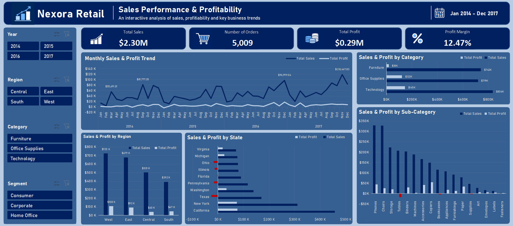
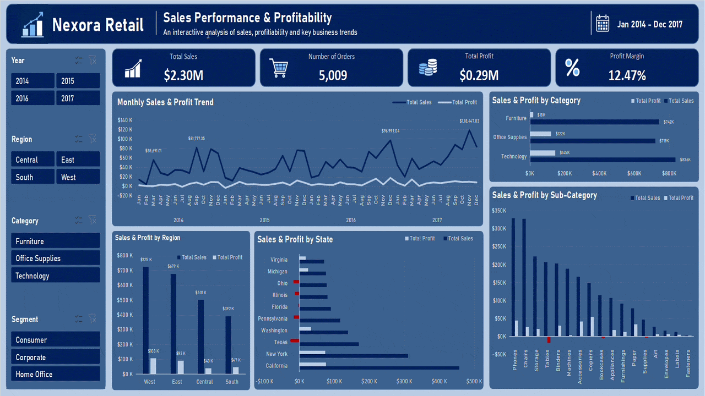

# Nexora Retail — Sales Performance & Profitability

An interactive Microsoft Excel dashboard exploring retail sales, profitability, regional trends, and product performance using the **Nexora_Retail_sales_2014–2017** dataset.

## Dashboard Preview



## Interactive Walkthrough



## Project Overview

The **Nexora_Retail_sales_2014–2017** dataset contains retail order data spanning 2014 to 2017. Total sales and profit provide a useful starting point, but they do not reveal which regions, categories, or products perform well—or where sales may be generating losses.

This project brings those views together in an interactive Excel dashboard. Users can filter the results and compare key metrics, sales trends, regional performance, category contributions, and product profitability.

The aim is to make business patterns easier to explore and support more informed decisions about pricing, discounts, and product performance.

## Key Results

| Metric | Result |
|---|---:|
| Total Sales | $2.30M |
| Total Profit | $286.40K |
| Distinct Orders | 5,009 |
| Profit Margin | 12.47% |

## Key Findings

- **Regional performance:** The West generated the highest sales and profit, while Central had the lowest regional profit margin at approximately 7.92%.
- **Category profitability:** Technology achieved a profit margin of approximately 17.40%, compared with 17.04% for Office Supplies and 2.49% for Furniture.
- **Sub-category losses:** Tables generated approximately $64.1K in losses, making it the largest loss-making sub-category in the analysis.
- **Discount impact:** Discounted orders generated a combined loss of approximately $34.6K, while full-price orders generated approximately $321.0K in profit. This relationship warrants further investigation; it does not establish that discounts alone caused the losses.
- **Product performance:** The analysis highlights products that contribute strongly to profit as well as high-sales products that fail to generate a positive return.

See [insights.md](insights.md) for the detailed findings, figures, and recommended actions.

## Dashboard Features

- KPI cards for sales, profit, order volume, and profit margin.
- Sales and profit trends across the 2014–2017 period.
- Regional and state-level performance analysis.
- Category and sub-category sales and profitability comparisons.
- Product and customer performance views.
- Discount-versus-profit analysis.
- Interactive filters for exploring different parts of the business.

## Tools & Techniques

- Microsoft Excel
- PivotTables and PivotCharts
- Interactive slicers and filtering
- Data cleaning and standardization
- KPI calculation and profitability analysis
- Dashboard layout, formatting, and data storytelling

## Repository Structure

```text
nexora-retail-sales-profitability/
├── README.md
├── insights.md
├── dashboard/
│   └── Nexora_Retail_Sales_Profitability.xlsx
├── images/
│   ├── dashboard_preview.png
│   └── dashboard_walkthrough.gif
└── data/
    └── sales_2014–2017
```

## How to Use

1. Open the Excel workbook in the `dashboard/` folder.
2. Use the available filters and slicers to explore the data.
3. Compare sales, profit, and margins across regions, categories, and products.
4. Read [insights.md](insights.md) for the main findings and areas for further investigation.

## Dataset

The project uses **Nexora_Retail_sales_2014–2017**, the project-specific name used for the original `sales_2014–2017` dataset. It contains retail order-line information, including sales, profit, discounts, product categories, customer segments, shipping modes, and geography.

The analysis covers orders from 2014 through 2017. Since the data is recorded at the order-line level, one order can contain multiple records.

## Author

Sahil Mallick
